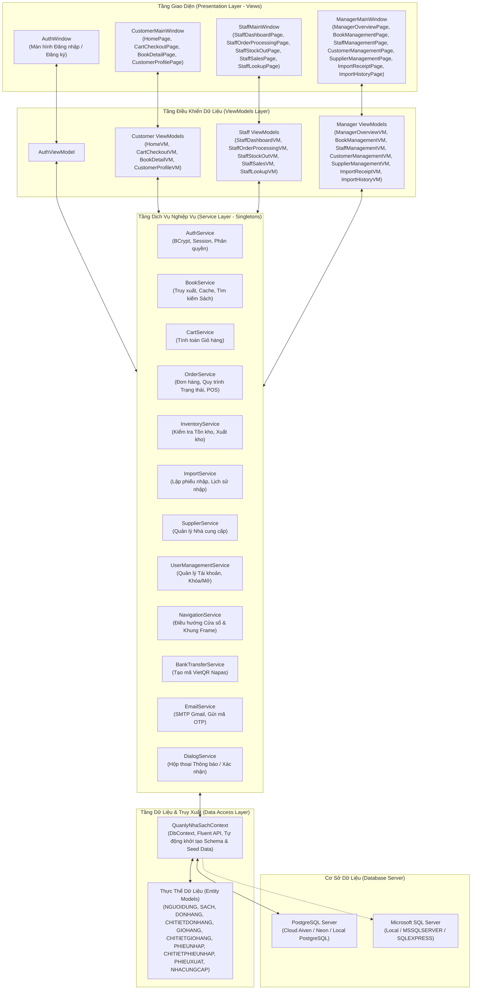
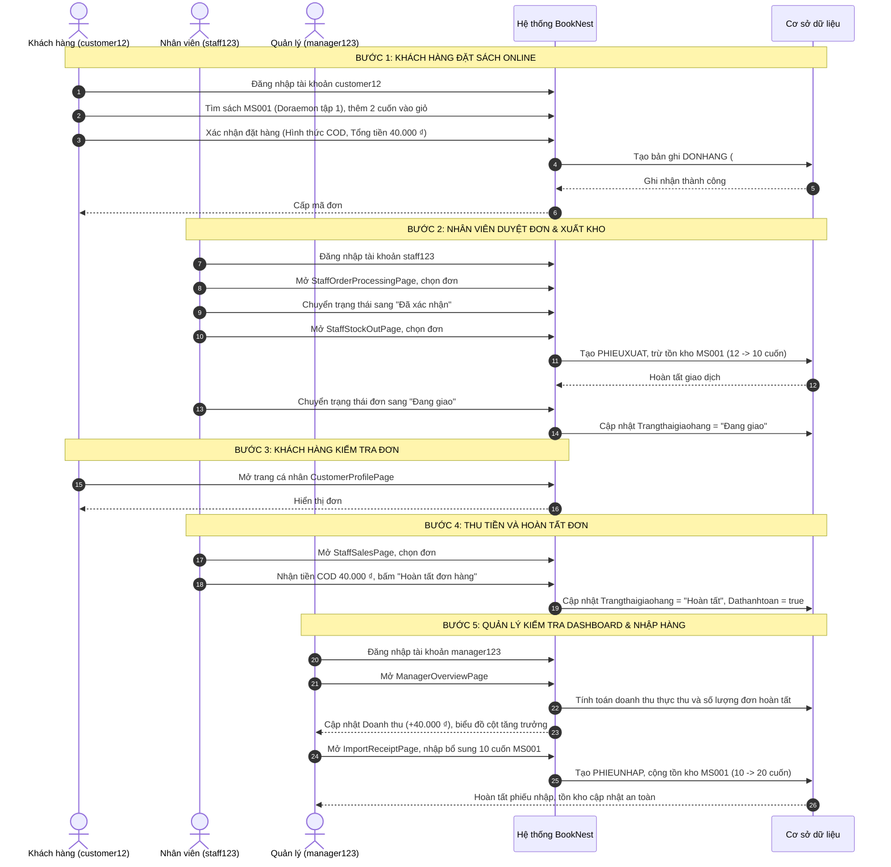

# HỆ THỐNG QUẢN LÝ NHÀ SÁCH

Hệ thống Quản lý Nhà sách (tên định danh dự án: BookNest - `QuanlyNhaSach`) là ứng dụng máy tính dành cho nền tảng Windows (Desktop Application), được nghiên cứu và phát triển bằng ngôn ngữ C# trên nền tảng .NET 8 và công nghệ Windows Presentation Foundation (WPF). Ứng dụng áp dụng mô hình kiến trúc Model-View-ViewModel (MVVM) với bộ công cụ CommunityToolkit.Mvvm, kết hợp cùng Entity Framework Core để truy xuất cơ sở dữ liệu quan hệ (hỗ trợ triển khai trên PostgreSQL và Microsoft SQL Server).

Hệ thống được thiết kế nhằm mục đích tin học hóa và tập trung hóa toàn bộ chu trình hoạt động của một nhà sách hiện đại: từ quản lý danh mục sách, lưu vết và cập nhật kho hàng, điều phối tiếp nhận và xử lý đơn hàng đa kênh, ghi nhận xuất nhập kho theo cơ chế giao dịch an toàn, đến quản trị đối tác cung cấp, người dùng, và cung cấp bảng điều khiển (Dashboard) phân tích trực quan kết quả kinh doanh.

| Thông tin thuộc tính | Chi tiết xác thực từ mã nguồn |
|---|---|
| Tên đồ án / Dự án | Hệ thống quản lý nhà sách (BookNest / QuanlyNhaSach) |
| Loại hình ứng dụng | Ứng dụng Desktop Windows (WPF .NET 8) |
| Ngôn ngữ lập trình | C# 12 (.NET SDK 8.0 trở lên, hỗ trợ RollForward) |
| Kiến trúc phần mềm | Model-View-ViewModel (MVVM) kết hợp Service Layer tập trung |
| Khung hỗ trợ MVVM | CommunityToolkit.Mvvm (phiên bản 8.4.2) |
| Công nghệ dữ liệu | Entity Framework Core 8.0.11 (Code-First / Reverse Engineering Model) |
| Hệ quản trị CSDL hỗ trợ | PostgreSQL (Cloud / Local) và Microsoft SQL Server |
| Cơ chế bảo mật | BCrypt.Net-Next (phiên bản 4.2.0, mã hóa muối mật khẩu) |
| Dịch vụ mở rộng | Tích hợp sinh mã VietQR động (NAPAS) và gửi mã xác thực OTP qua SMTP Gmail |

---

## MỤC LỤC

- [1. TỔNG QUAN ĐỀ TÀI](#1-tổng-quan-đề-tài)
  - [1.1. Giới thiệu đề tài](#11-giới-thiệu-đề-tài)
  - [1.2. Mục tiêu đề tài](#12-mục-tiêu-đề-tài)
  - [1.3. Phạm vi đề tài](#13-phạm-vi-đề-tài)
- [2. PHÂN TÍCH CHỨC NĂNG HỆ THỐNG](#2-phân-tích-chức-năng-hệ-thống)
  - [2.1. Actor 1 – Khách hàng](#21-actor-1--khách-hàng)
  - [2.2. Actor 2 – Nhân viên](#22-actor-2--nhân-viên)
  - [2.3. Actor 3 – Quản lý/Admin](#23-actor-3--quản-lýadmin)
- [3. KIẾN TRÚC VÀ CÔNG NGHỆ SỬ DỤNG](#3-kiến-trúc-và-công-nghệ-sử-dụng)
  - [3.1. Công nghệ phát triển](#31-công-nghệ-phát-triển)
  - [3.2. Kiến trúc hệ thống](#32-kiến-trúc-hệ-thống)
  - [3.3. Cấu trúc thư mục dự án](#33-cấu-trúc-thư-mục-dự-án)
  - [3.4. Mô hình dữ liệu và cơ sở dữ liệu](#34-mô-hình-dữ-liệu-và-cơ-sở-dữ-liệu)
- [4. YÊU CẦU HỆ THỐNG VÀ MÔI TRƯỜNG](#4-yêu-cầu-hệ-thống-và-môi-trường)
  - [4.1. Yêu cầu phần cứng](#41-yêu-cầu-phần-cứng)
  - [4.2. Yêu cầu phần mềm](#42-yêu-cầu-phần-mềm)
  - [4.3. Kiểm tra môi trường](#43-kiểm-tra-môi-trường)
- [5. HƯỚNG DẪN CÀI ĐẶT VÀ TRIỂN KHAI](#5-hướng-dẫn-cài-đặt-và-triển-khai)
  - [5.1. Lấy mã nguồn dự án](#51-lấy-mã-nguồn-dự-án)
  - [5.2. Mở solution](#52-mở-solution)
  - [5.3. Khôi phục các thư viện cần thiết](#53-khôi-phục-các-thư-viện-cần-thiết)
  - [5.4. Khôi phục cơ sở dữ liệu](#54-khôi-phục-cơ-sở-dữ-liệu)
  - [5.5. Cấu hình kết nối cơ sở dữ liệu](#55-cấu-hình-kết-nối-cơ-sở-dữ-liệu)
  - [5.6. Biên dịch dự án](#56-biên-dịch-dự-án)
  - [5.7. Khởi chạy ứng dụng](#57-khởi-chạy-ứng-dụng)
  - [5.8. Các lỗi thường gặp và cách khắc phục](#58-các-lỗi-thường-gặp-và-cách-khắc-phục)
- [6. TÀI KHOẢN ĐĂNG NHẬP DEMO](#6-tài-khoản-đăng-nhập-demo)
- [7. DỮ LIỆU SEED VÀ KỊCH BẢN DEMO NGHIỆM THU](#7-dữ-liệu-seed-và-kịch-bản-demo-nghiệm-thu)
  - [7.1. Giới thiệu dữ liệu mẫu](#71-giới-thiệu-dữ-liệu-mẫu)
  - [7.2. Danh mục dữ liệu mẫu](#72-danh-mục-dữ-liệu-mẫu)
  - [7.3. Kịch bản demo theo từng Actor](#73-kịch-bản-demo-theo-từng-actor)
  - [7.4. Kịch bản demo tổng hợp](#74-kịch-bản-demo-tổng-hợp)
  - [7.5. Kết quả nghiệm thu mong đợi](#75-kết-quả-nghiệm-thu-mong-đợi)
- [8. GIỚI HẠN VÀ HƯỚNG PHÁT TRIỂN](#8-giới-hạn-và-hướng-phát-triển)
- [9. KẾT LUẬN](#9-kết-luận)
- [10. TÀI LIỆU THAM KHẢO](#10-tài-liệu-tham-khảo)

---

## 1. TỔNG QUAN ĐỀ TÀI

### 1.1. Giới thiệu đề tài

Hoạt động kinh doanh và phát hành xuất bản phẩm tại các nhà sách truyền thống thường đối mặt với nhiều khó khăn trong khâu quản lý thủ công: dữ liệu tồn kho phân tán dẫn đến sai lệch số lượng thực tế, quy trình tiếp nhận và duyệt đơn hàng trực tuyến chậm trễ, thông tin giá cả và biến động nguồn cung thiếu sự liên kết đồng bộ, và khó khăn trong việc tổng hợp báo cáo kinh doanh tức thời cho cấp quản lý.

Đề tài "Hệ thống quản lý nhà sách" được triển khai nhằm giải quyết các tồn tại trên bằng cách xây dựng một ứng dụng máy tính nguyên khối (Desktop Application) vững chắc, có tính tương tác cao và đảm bảo tính toàn vẹn dữ liệu. Hệ thống số hóa và tự động hóa các nghiệp vụ chính bao gồm:

- Quản lý tập trung toàn bộ danh mục xuất bản phẩm, thông tin tác giả, thể loại, nhà xuất bản, đơn giá niêm yết và số lượng lưu trữ khả dụng.
- Quản lý chặt chẽ chu trình kho hàng, ghi nhận phiếu nhập hàng từ đối tác xuất bản và xuất kho tương ứng với đơn hàng bán lẻ.
- Tự động hóa quy trình đặt hàng dành cho khách hàng với nhiều hình thức thanh toán (tiền mặt khi nhận hàng COD, chuyển khoản ngân hàng qua mã VietQR).
- Hỗ trợ nhân viên thu ngân tại quầy (POS) thực hiện tính tiền nhanh, tự động kiểm tra số lượng tồn kho khả dụng để ngăn chặn bán vượt số lượng tồn và tự động tính tiền thối lại cho khách.
- Cung cấp giao diện làm việc chuyên biệt theo cơ chế kiểm soát truy cập dựa trên vai trò (Role-Based Access Control - RBAC).
- Tổng hợp và trực quan hóa các chỉ số hiệu suất kinh doanh (KPIs), biểu đồ doanh thu theo nhiều chu kỳ thời gian và danh sách đầu sách bán chạy giúp cấp quản lý đưa ra quyết định kịp thời.

### 1.2. Mục tiêu đề tài

- Chuẩn hóa toàn diện quy trình vận hành nhà sách từ khâu nhập kho, trưng bày, tư vấn, bán lẻ đến điều phối vận chuyển.
- Tập trung hóa dữ liệu kinh doanh vào hệ thống cơ sở dữ liệu quan hệ, loại bỏ hoàn toàn việc lưu trữ phân tán trên sổ sách hoặc tệp bảng tính rời rạc.
- Đảm bảo tính chính xác và an toàn của dữ liệu tồn kho thông qua các giao dịch cơ sở dữ liệu có tính chất nguyên tố (Atomic Transactions).
- Tối ưu hóa thời gian xử lý đơn hàng của nhân viên và mang lại trải nghiệm tra cứu, đặt mua thuận tiện cho khách hàng.
- Nâng cao năng lực giám sát và điều hành của chủ nhà sách thông qua báo cáo thống kê trực quan, cảnh báo tự động khi lượng tồn kho chạm ngưỡng giới hạn.
- Đảm bảo tính bảo mật hệ thống bằng việc mã hóa mật khẩu người dùng với thuật toán BCrypt và phân tách quyền hạn tuyệt đối giữa các nhóm người dùng.

### 1.3. Phạm vi đề tài

Phạm vi nghiệp vụ được hiện thực hóa đầy đủ trong mã nguồn dự án bao gồm:

- Phân hệ xác thực và bảo mật: Đăng nhập bằng tên tài khoản hoặc địa chỉ thư điện tử; đăng ký tài khoản khách hàng mới có xác minh mã OTP gửi qua hộp thư Gmail; phân quyền tự động điều hướng người dùng sau khi xác thực.
- Phân hệ khách hàng: Duyệt danh mục sách, tìm kiếm sách theo tên/tác giả/mã sách, lọc theo trạng thái còn hàng/hết hàng, sắp xếp theo giá cả/ngày phát hành, quản lý giỏ hàng cục bộ, thực hiện đặt hàng thanh toán COD hoặc VietQR, theo dõi trạng thái đơn hàng thời gian thực, xem và cập nhật thông tin cá nhân.
- Phân hệ nhân viên: Theo dõi thống kê nhanh ca làm việc (Dashboard nhân viên); bán hàng trực tiếp tại quầy (POS) có tính tiền thừa; tiếp nhận, lọc và chuyển đổi trạng thái đơn hàng trực tuyến; kiểm tra điều kiện tồn kho và thực hiện xuất kho chính thức.
- Phân hệ quản lý: Xem báo cáo tổng quan kết quả kinh doanh (doanh thu, số lượng đơn hàng, Top 5 sách bán chạy, danh sách cảnh báo tồn kho thấp dưới 10 cuốn, biểu đồ cột doanh thu 7 ngày / 14 ngày / 30 ngày / 12 tháng); quản lý danh mục sách (thêm mới, chỉnh sửa, xóa mềm an toàn); quản lý đối tác cung cấp; quản lý nhân viên (tạo tài khoản cấp quyền, tạm khóa/mở khóa tài khoản); quản lý khách hàng (khóa/mở khóa, cấp lại mật khẩu ngẫu nhiên); lập phiếu nhập hàng cập nhật kho và tra cứu lịch sử nhập hàng chi tiết.

Các tính năng nằm ngoài phạm vi hiện tại của đề tài:

- Tích hợp cổng thanh toán trực tuyến qua thẻ tín dụng quốc tế (Visa/Mastercard) với cơ chế Webhook phản hồi tức thời từ cổng thanh toán bên thứ ba (hệ thống hiện sử dụng quét mã VietQR đối soát thủ công và tiền mặt/COD).
- Phân hệ tính toán lương thưởng hoặc quản lý ca kíp chuyên sâu của nhân sự.
- Tính năng lưu danh sách sách yêu thích (Wishlist) cho khách hàng (hiện tại trong mã nguồn là thông báo phát triển cho phiên bản tiếp theo).

---

## 2. PHÂN TÍCH CHỨC NĂNG HỆ THỐNG

Hệ thống phân định quyền hạn tác nghiệp thông qua ba Actor chính: Khách hàng (Customer), Nhân viên (Staff), và Quản lý/Admin (Manager). Mỗi Actor được cấp một cổng giao diện độc lập và bộ dịch vụ tương ứng.

### 2.1. Actor 1 – Khách hàng

Khách hàng truy cập hệ thống thông qua giao diện `CustomerMainWindow`. Các chức năng chính bao gồm:

- **Tra cứu và xem thông tin sách:**
  - Khách hàng xem danh mục toàn bộ sách đang phát hành tại màn hình `HomePage`.
  - Hệ thống cung cấp thanh tìm kiếm tức thời theo từ khóa (tên sách, tên tác giả, mã sách).
  - Khách hàng có thể lọc sách theo trạng thái tồn kho ("Tất cả tình trạng", "Còn hàng", "Hết hàng") và sắp xếp theo tiêu chí ("Mới nhất", "Giá: Thấp đến Cao", "Giá: Cao đến Thấp").
  - Khi nhấn chọn một đầu sách, màn hình `BookDetailPage` hiển thị đầy đủ thông tin: tiêu đề sách, tác giả, thể loại, nhà xuất bản, đơn giá, ảnh bìa và số lượng sách hiện có trong kho.

- **Quản lý giỏ hàng:**
  - Khách hàng có thể thêm sách vào giỏ hàng từ trang danh mục hoặc trang chi tiết sách.
  - Tại trang `CartCheckoutPage`, khách hàng có thể kiểm tra danh sách sản phẩm, điều chỉnh tăng giảm số lượng mua bằng nút bấm hoặc nhập trực tiếp. Hệ thống tự động giới hạn số lượng không được vượt quá số lượng tồn kho khả dụng.
  - Cho phép xóa từng sản phẩm hoặc làm trống toàn bộ giỏ hàng; hệ thống tự động tính toán tổng số lượng và tổng số tiền thanh toán theo thời gian thực.

- **Đặt hàng và thanh toán:**
  - Khách hàng nhập thông tin nhận hàng bắt buộc bao gồm: Họ và tên, Số điện thoại (yêu cầu chuẩn 10 chữ số), Địa chỉ nhận hàng, và Địa chỉ thư điện tử (bắt buộc định dạng hợp lệ kết thúc bằng `@gmail.com`).
  - Lựa chọn một trong hai phương thức thanh toán:
    - *COD — Thanh toán khi nhận hàng:* Đơn hàng được khởi tạo với trạng thái ban đầu là "Mới" và trạng thái thanh toán là "Thu hộ (COD)".
    - *Chuyển khoản ngân hàng (VietQR):* Hệ thống hiển thị cửa sổ thanh toán tích hợp mã VietQR động được tạo bởi dịch vụ `BankTransferService`. Mã QR chứa thông tin số tài khoản thụ hưởng, tên chủ tài khoản, số tiền chính xác của đơn hàng và cú pháp nội dung chuyển khoản chuẩn hóa (`TT #DHxxxx <SĐT>`). Sau khi thực hiện chuyển khoản, khách hàng xác nhận đã hoàn tất chuyển tiền để hệ thống lưu trữ giao dịch.

- **Theo dõi lịch sử đơn hàng:**
  - Tại trang `CustomerProfilePage` (mục "Lịch sử mua hàng"), khách hàng có thể tra cứu toàn bộ các đơn hàng do mình thiết lập.
  - Danh sách đơn hàng được sắp xếp theo thời gian đặt gần nhất, hiển thị rõ mã đơn hàng (ví dụ: `#DH0001`), ngày tạo, tổng tiền, phương thức thanh toán và trạng thái xử lý hiện tại (*Mới*, *Đã xác nhận*, *Đang giao*, *Hoàn tất*, *Đã hủy*).
  - Khách hàng có thể chọn từng đơn hàng để xem danh sách chi tiết các cuốn sách, số lượng mua và thành tiền.

- **Quản lý thông tin cá nhân:**
  - Khách hàng xem và cập nhật thông tin cá nhân bao gồm: Họ và tên, Số điện thoại, Địa chỉ email, và Ngày tham gia hệ thống.
  - Hệ thống kiểm tra trùng lặp email và số điện thoại với các tài khoản khác trước khi ghi nhận thay đổi vào cơ sở dữ liệu.

### 2.2. Actor 2 – Nhân viên

Nhân viên nhà sách đăng nhập và làm việc trên giao diện `StaffMainWindow`. Các chức năng chính bao gồm:

- **Bảng điều khiển tác nghiệp (`StaffDashboardPage`):**
  - Cung cấp các thẻ thống kê tổng hợp: Số đơn hàng mới phát sinh, số đơn đã xác nhận, số đơn đang giao hàng, số đơn đã hoàn tất và số đơn đã hủy.
  - Hiển thị tổng doanh thu tích lũy từ các đơn hàng đã thanh toán thành công và số lượng đầu sách đang có nguy cơ hết hàng (tồn kho dưới hoặc bằng 5 cuốn).
  - Danh sách "Đơn hàng khẩn cấp cần xử lý" liệt kê các đơn hàng chưa hoàn tất, cho phép nhân viên bấm các nút tác vụ nhanh để chuyển thẳng tới màn hình xử lý đơn, màn hình xuất kho hoặc màn hình thu tiền.

- **Tiếp nhận và xử lý đơn hàng trực tuyến (`StaffOrderProcessingPage`):**
  - Tiếp nhận danh sách các đơn hàng do khách hàng đặt từ xa.
  - Hỗ trợ các bộ lọc trạng thái linh hoạt: "Đơn cần xử lý (Mới, Xác nhận, Đang giao)", "Tất cả đơn hàng", "Lịch sử đơn hàng (Đã hoàn tất)", hoặc lọc cụ thể theo từng trạng thái.
  - Có thanh tìm kiếm tức thời và gợi ý mã đơn hàng, tên khách hàng hoặc số điện thoại.
  - Quy trình quản lý vòng đời đơn hàng (Order Lifecycle) được kiểm soát nghiêm ngặt theo các quy tắc nghiệp vụ:
    - Trạng thái `Mới`: Đơn hàng chờ tiếp nhận. Nhân viên có thể chuyển sang `Đã xác nhận` hoặc `Đã hủy`. Đối với các đơn hàng chọn hình thức chuyển khoản, nhân viên phải nhấn nút "Duyệt CK" (xác nhận ngân quỹ đã nhận tiền) trước khi hệ thống cho phép chuyển sang `Đã xác nhận`.
    - Trạng thái `Đã xác nhận`: Đơn hàng đã được duyệt tính hợp lệ. Để chuyển sang `Đang giao`, hệ thống bắt buộc đơn hàng PHẢI ĐƯỢC XUẤT KHO TRƯỚC. Nếu đơn hàng chưa có phiếu xuất kho (`StockOutStatus != Issued`), thao tác chuyển trạng thái sẽ bị chặn lại kèm cảnh báo lỗi.
    - Trạng thái `Đang giao`: Đơn hàng đã bàn giao cho nhân viên giao vận. Hệ thống nghiêm cấm thao tác hủy đơn trực tiếp khi đơn hàng đang trên đường giao.
    - Trạng thái `Hoàn tất`: Để hoàn tất đơn hàng, hệ thống kiểm tra điều kiện thanh toán (`PaymentStatus == Paid`). Nếu đơn hàng là COD, nhân viên phải xác nhận đã thu đủ tiền mặt từ đơn vị giao nhận hoặc khách hàng.
    - Trạng thái `Đã hủy`: Khi đơn hàng bị hủy, nếu đơn hàng đó trước đó đã được tạo phiếu xuất kho, hệ thống sẽ tự động hoàn trả lại số lượng sách đã xuất vào kho dữ liệu (`SACH.Soluongton`) và gỡ bỏ phiếu xuất kho tương ứng. Nếu đơn hàng đã được thu tiền trước đó, trạng thái thanh toán sẽ tự động chuyển thành "Hoàn tiền".

- **Quản lý giao dịch xuất kho (`StaffStockOutPage`):**
  - Nhân viên lựa chọn đơn hàng cần xuất sách. Hệ thống hiển thị bảng chi tiết các cuốn sách cần đóng gói cùng số lượng yêu cầu và số lượng tồn kho hiện tại.
  - Hệ thống kiểm tra điều kiện tồn kho thông qua phương thức `InventoryService.ValidateStockOut`. Nếu bất kỳ đầu sách nào có số lượng tồn kho nhỏ hơn số lượng yêu cầu trong đơn, thao tác xuất kho sẽ bị từ chối.
  - Khi nhân viên nhấn "Xác nhận xuất kho", hệ thống khởi tạo bản ghi trong bảng `PHIEUXUAT`, trừ trực tiếp số lượng sách trong bảng `SACH`, cập nhật trạng thái xuất kho của đơn hàng thành "Đã xuất kho" và tự động kích hoạt sự kiện làm mới bộ nhớ đệm (Cache) trên toàn hệ thống.

- **Bán hàng tại quầy / Điểm bán lẻ POS (`StaffSalesPage`):**
  - Hỗ trợ nhân viên thu ngân tiếp nhận thanh toán trực tiếp cho khách hàng mua sách tại cửa hàng.
  - Cho phép lựa chọn phương thức thanh toán: Tiền mặt, Chuyển khoản VietQR, hoặc ghi nhận giao hàng COD.
  - Đối với hình thức Tiền mặt, nhân viên nhập số tiền khách đưa. Hệ thống tự động kiểm tra số tiền nhập phải lớn hơn hoặc bằng tổng giá trị đơn hàng và hiển thị chính xác số tiền thừa (tiền thối) cần trả lại cho khách.
  - Bấm "Ghi nhận thanh toán" để xác nhận giao dịch, cập nhật trạng thái đơn thành "Đã thanh toán".

- **Tra cứu sách và kiểm tra vị trí kho (`StaffLookupPage`):**
  - Cung cấp công cụ tra cứu tức thời cho nhân viên phục vụ công tác tư vấn tại quầy: tìm kiếm theo mã sách, tiêu đề, tác giả, thể loại, đơn giá niêm yết và số lượng còn trong kho.

### 2.3. Actor 3 – Quản lý/Admin

Quản lý/Admin là người nắm toàn quyền điều hành hệ thống thông qua giao diện `ManagerMainWindow` với 7 chuyên mục nghiệp vụ:

- **Bảng điều khiển và thống kê kinh doanh (`ManagerOverviewPage`):**
  - Cung cấp 4 thẻ chỉ số hiệu suất kinh doanh (KPIs):
    - *Tổng doanh thu:* Tính toán chính xác trên các đơn hàng đã ở trạng thái `Hoàn tất` và có trạng thái thanh toán là `Đã thanh toán`.
    - *Tổng số đơn hàng:* Thống kê toàn bộ số lượng đơn hàng phát sinh, phân rã chi tiết số đơn hoàn tất, số đơn đang xử lý và số đơn đã hủy.
    - *Đầu sách bán chạy nhất:* Xác định cuốn sách có tổng số lượng bán ra cao nhất trong các đơn hàng đã thanh toán thành công, hiển thị số lượng đã bán và doanh thu đóng góp.
    - *Cảnh báo tồn kho thấp:* Đếm tổng số đầu sách có lượng tồn kho dưới 10 cuốn, phân tách số lượng sách đã hết sạch hàng (0 cuốn) và số lượng sách sắp hết hàng (từ 1 đến 9 cuốn).
  - *Biểu đồ cột trực quan (Revenue Bar Chart):* Vẽ biểu đồ doanh thu theo các chu kỳ linh hoạt do quản lý lựa chọn: 7 ngày gần nhất, 14 ngày gần nhất, 30 ngày gần nhất hoặc 12 tháng gần nhất. Biểu đồ tự động co giãn chiều cao cột (tối đa 170 pixel) tương ứng với giá trị doanh thu cao nhất trong kỳ và hỗ trợ hiển thị thông tin chi tiết qua Tooltip.
  - *Bảng xếp hạng Top 5 sách bán chạy:* Liệt kê thứ hạng (Rank 1 đến 5), mã sách, tên sách, tác giả, số lượng bán ra và tổng doanh thu thu về.
  - *Bảng cảnh báo tồn kho thấp:* Hiển thị danh sách các đầu sách có nguy cơ đứt hàng để quản lý nhanh chóng lập kế hoạch nhập hàng bổ sung.

- **Quản lý danh mục sách (`BookManagementPage`):**
  - Xem danh sách đầy đủ tất cả sách trong hệ thống. Hỗ trợ lọc theo tình trạng kho ("Tất cả", "Đủ hàng >= 10", "Sắp hết < 10", "Hết hàng = 0") và tìm kiếm theo tên sách/tác giả/mã sách có gợi ý tự động.
  - *Thêm sách mới:* Nhập thông tin mã sách (tự động gợi ý mã tăng tiến `MSxxx`), tên sách, tác giả, thể loại, nhà xuất bản, mã nhà cung cấp hợp tác, giá bán, số lượng tồn ban đầu và tên tệp ảnh bìa sách.
  - *Chỉnh sửa thông tin sách:* Cập nhật giá bán, thể loại, nhà xuất bản hoặc đường dẫn ảnh bìa.
  - *Xóa sách an toàn:* Khi người dùng yêu cầu xóa một đầu sách, hệ thống kiểm tra dữ liệu phụ thuộc trong cơ sở dữ liệu. Nếu cuốn sách đã từng phát sinh giao dịch trong đơn hàng (`CHITIETDONHANG`), phiếu nhập hàng (`CHITIETPHIEUNHAP`) hoặc đang có trong giỏ hàng (`CHITIETGIOHANG`), hệ thống sẽ thực hiện xóa mềm (đặt cờ `Daxoa = true`) để bảo tồn toàn vẹn dữ liệu lịch sử kế toán. Ngược lại, nếu chưa có giao dịch nào liên quan, sách sẽ được xóa hoàn toàn khỏi bảng.

- **Quản lý nhà cung cấp (`SupplierManagementPage`):**
  - Quản lý danh sách đối tác xuất bản và nhà phân phối sách: Mã nhà cung cấp (`NCCxxxx`), Tên nhà cung cấp, Số điện thoại, Địa chỉ email, Địa chỉ trụ sở và Trạng thái hợp tác.
  - Cho phép thêm mới nhà cung cấp (hệ thống tự động sinh mã tăng tiến, kiểm tra tính hợp lệ của số điện thoại và định dạng email).
  - Cập nhật thông tin chi tiết hoặc chuyển đổi trạng thái hợp tác giữa "Đang hợp tác" và "Tạm ngừng hợp tác".

- **Quản lý nhân viên (`StaffManagementPage`):**
  - Quản lý hồ sơ đội ngũ nhân viên: Mã nhân viên (`NVxxx`), Họ và tên, Tên đăng nhập, Số điện thoại, Email, Địa chỉ và Trạng thái tài khoản.
  - *Thêm tài khoản nhân viên mới:* Cấp tài khoản nhân viên với mật khẩu được mã hóa tự động bằng BCrypt; hệ thống đồng thời phát sinh mã xác thực và gửi thư thông báo tới địa chỉ email của nhân viên thông qua `EmailService`.
  - *Khóa / Mở khóa tài khoản nhân viên:* Cho phép quản lý vô hiệu hóa quyền truy cập của nhân viên đã thôi việc hoặc có dấu hiệu vi phạm; tài khoản bị khóa sẽ lập tức bị từ chối khi thực hiện đăng nhập.

- **Quản lý khách hàng (`CustomerManagementPage`):**
  - Xem danh sách toàn bộ khách hàng đã đăng ký tài khoản trong hệ thống.
  - Hỗ trợ tìm kiếm theo tên, số điện thoại, email hoặc mã khách hàng (`KHxxx`).
  - *Khóa / Mở khóa tài khoản khách hàng:* Ngăn chặn hành vi đặt hàng của các tài khoản ảo hoặc gian lận mà vẫn bảo toàn đầy đủ dữ liệu đơn hàng cũ.
  - *Cấp lại mật khẩu khách hàng:* Hỗ trợ khách hàng quên mật khẩu bằng cách sinh tự động một mật khẩu tạm thời ngẫu nhiên (chuẩn định dạng `NS@xxxx`), mã hóa lưu vào CSDL và hiển thị một lần duy nhất cho quản lý để bàn giao lại cho khách.

- **Lập phiếu nhập hàng (`ImportReceiptPage`):**
  - Khởi tạo phiếu nhập bổ sung xuất bản phẩm vào kho lưu trữ:
    - Lựa chọn Nhà cung cấp đang hoạt động từ danh sách.
    - Tìm kiếm sách trong hệ thống và đưa vào danh sách nhập nháp.
    - Nhập số lượng cần nhập (>= 1) và đơn giá nhập gốc (> 0 đ). Hệ thống tự động tính thành tiền từng món và tổng giá trị thanh toán của phiếu nhập.
    - Kiểm tra giới hạn tràn số dữ liệu kiểu Decimal và Byte trước khi ghi dữ liệu.
    - Khi quản lý nhấn "Xác nhận nhập hàng", hệ thống thực hiện giao dịch CSDL (Transaction): lưu thông tin `PHIEUNHAP`, lưu danh sách `CHITIETPHIEUNHAP` và cộng tăng trực tiếp số lượng tồn kho của từng cuốn sách trong bảng `SACH`.

- **Lịch sử nhập hàng (`ImportHistoryPage`):**
  - Tra cứu toàn bộ các phiếu nhập hàng đã được phê duyệt trong lịch sử theo mã phiếu (`PNxxxx`), nhà cung cấp hoặc người lập.
  - Xem cửa sổ chi tiết (Modal Dialog) của từng phiếu nhập: Ngày giờ lập phiếu, người ký duyệt, nhà cung cấp, chi tiết các đầu sách đã nhập kèm số lượng, đơn giá nhập và tổng kinh phí đã giải ngân.

---

## 3. KIẾN TRÚC VÀ CÔNG NGHỆ SỬ DỤNG

### 3.1. Công nghệ phát triển

Dự án áp dụng nền tảng công nghệ chính thức được xác thực trực tiếp từ tệp dự án `QuanlyNhaSach.csproj` và cấu trúc mã nguồn:

| Thành phần hệ thống | Công nghệ / Thư viện | Phiên bản | Vai trò trong hệ thống |
|---|---|---|---|
| Ngôn ngữ phát triển | C# (C Sharp) | 12.0 | Ngôn ngữ lập trình hướng đối tượng chính của ứng dụng |
| Nền tảng thực thi | .NET SDK | 8.0 (net8.0-windows) | Môi trường biên dịch và thực thi ứng dụng Windows |
| Công nghệ giao diện | WPF (Windows Presentation Foundation) | 8.0 | Xây dựng giao diện đồ họa người dùng bằng XAML |
| Kiến trúc giao diện | MVVM (Model-View-ViewModel) | N/A | Tách biệt giao diện người dùng và logic xử lý nghiệp vụ |
| MVVM Toolkit | CommunityToolkit.Mvvm | 8.4.2 | Cung cấp ObservableObject, ObservableValidator, RelayCommand |
| ORM (Truy xuất dữ liệu) | Microsoft.EntityFrameworkCore | 8.0.11 | Quản lý mô hình thực thể và ánh xạ CSDL quan hệ |
| Công cụ thiết kế EF | Microsoft.EntityFrameworkCore.Design | 8.* | Hỗ trợ cấu hình và reverse engineering cơ sở dữ liệu |
| Công cụ CLI EF | Microsoft.EntityFrameworkCore.Tools | 8.0.11 | Hỗ trợ quản lý mô hình dữ liệu qua câu lệnh |
| CSDL Quan hệ mặc định | Npgsql.EntityFrameworkCore.PostgreSQL | 8.0.11 | Kết nối CSDL PostgreSQL (Cloud Aiven/Neon/Supabase hoặc Local) |
| CSDL Quan hệ dự phòng | Microsoft.EntityFrameworkCore.SqlServer | 8.0.11 | Hỗ trợ kết nối CSDL Microsoft SQL Server truyền thống |
| Mã hóa mật khẩu | BCrypt.Net-Next | 4.2.0 | Mã hóa băm muối (salted hash) an toàn cho mật khẩu tài khoản |
| Dịch vụ thư điện tử | System.Net.Mail | Tích hợp .NET | Gửi mã OTP xác thực tài khoản qua giao thức SMTP Gmail TLS |
| Thanh toán trực tuyến | VietQR API Client | Tích hợp nội bộ | Sinh mã QR NAPAS động hiển thị trực tiếp lên giao diện |

### 3.2. Kiến trúc hệ thống

Ứng dụng áp dụng kiến trúc Model-View-ViewModel (MVVM) đa tầng kết hợp tầng Dịch vụ nghiệp vụ (Service Layer) tập trung:



Nguyên lý luồng dữ liệu và tương tác:

- **View (Giao diện XAML):** Đóng vai trò hiển thị và bắt giữ hành vi người dùng, không chứa mã logic nghiệp vụ. Sử dụng cơ chế Data Binding liên kết 2 chiều với các thuộc tính trong ViewModel.
- **ViewModel:** Kế thừa từ `ObservableObject` hoặc `ObservableValidator`, công khai các thuộc tính để View liên kết hiển thị, phát đi thông báo `PropertyChanged` khi dữ liệu thay đổi, và tiếp nhận lệnh thông qua `[RelayCommand]`.
- **Service Layer (Tầng Dịch vụ):** Cung cấp các thao tác nghiệp vụ cốt lõi, duy trì bộ nhớ đệm (In-memory Cache) để giảm tải truy vấn lặp lại đến CSDL, phát đi các sự kiện đồng bộ chéo giữa các phân hệ (ví dụ: `ImportReceiptConfirmed` kích hoạt `BookService.InvalidateCache()`).
- **Data Access Layer (QuanlyNhaSachContext):** Kế thừa từ `DbContext` của Entity Framework Core, đảm nhiệm việc mở kết nối, sinh câu truy vấn SQL tối ưu, thực thi các Transaction đảm bảo tính toàn vẹn và ánh xạ dữ liệu thành các đối tượng C#.

### 3.3. Cấu trúc thư mục dự án

Mã nguồn dự án được tổ chức theo cấu trúc phân tầng rõ ràng như sau:

```text
QuanlyNhaSach/
│
├── .vscode/                               # Cấu hình môi trường phát triển Visual Studio Code
│   └── settings.json
├── QuanlyNhaSach.sln                      # Tệp cấu hình Solution chính của dự án
├── README.md                              # Báo cáo kỹ thuật và tài liệu hướng dẫn hệ thống
│
└── QuanlyNhaSach/                         # Thư mục chứa mã nguồn ứng dụng WPF chính
    ├── App.xaml                           # Định nghĩa tài nguyên ứng dụng toàn cục (Resource Dictionary)
    ├── App.xaml.cs                        # Điểm khởi chạy (Entry Point), khởi tạo Service Container và AuthWindow
    ├── AssemblyInfo.cs                    # Khai báo thuộc tính và thông tin định danh Assembly
    ├── MainWindow.xaml / .cs              # Cửa sổ chuyển tiếp mặc định của dự án
    ├── QuanlyNhaSach.csproj               # Tệp cấu hình dự án .NET 8, gói NuGet dependencies và tài nguyên
    │
    ├── DBQuanLyNhaSach.sql                # Kịch bản SQL tạo bảng và nạp dữ liệu cho Microsoft SQL Server
    ├── DBQuanLyNhaSach_PostgreSQL.sql     # Kịch bản SQL tạo bảng và nạp dữ liệu cho PostgreSQL
    ├── dbsettings.example.json            # Mẫu cấu hình chuỗi kết nối CSDL đám mây PostgreSQL
    ├── banksettings .example.json         # Mẫu cấu hình thông tin tài khoản ngân hàng nhận chuyển khoản VietQR
    ├── emailsettings.example.json         # Mẫu cấu hình tài khoản gửi thư điện tử SMTP Gmail và mã OTP
    │
    ├── Controls/                          # Các điều khiển giao diện tùy biến (Custom Controls)
    │   ├── TogglePasswordBox.xaml         # Điều khiển nhập mật khẩu hỗ trợ bật/tắt hiển thị ký tự
    │   └── TogglePasswordBox.xaml.cs
    │
    ├── Converters/                        # Bộ chuyển đổi giá trị dữ liệu trong XAML (IValueConverter)
    │   ├── PasswordBoxHelper.cs           # Hỗ trợ đính kèm mật khẩu cho PasswordBox chuẩn WPF
    │   └── ValueConverters.cs             # Chuyển đổi định dạng tiền tệ, màu sắc, ẩn hiện điều khiển
    │
    ├── Img/                               # Thư mục lưu trữ hình ảnh tài nguyên tĩnh và ảnh bìa sách
    │   └── MS001_Doraemon_FujiKo_F_Fujio.jpg
    │
    ├── Models/                            # Các lớp thực thể dữ liệu (Entity Models) và Enums
    │   ├── QuanLyNhaSachContext.cs        # Lớp DbContext chính, cấu hình kết nối và tự động khởi tạo dữ liệu
    │   ├── NGUOIDUNG.cs / .Extended.cs    # Thực thể Người dùng, phân quyền và trạng thái
    │   ├── SACH.cs / .Extended.cs         # Thực thể Sách, định dạng hiển thị, tính toán tồn kho
    │   ├── DONHANG.cs / .Extended.cs      # Thực thể Đơn hàng, quản lý vòng đời và phương thức thanh toán
    │   ├── CHITIETDONHANG.cs              # Thực thể Chi tiết đơn hàng (khóa ngoại kép Đơn hàng - Sách)
    │   ├── GIOHANG.cs                     # Thực thể Giỏ hàng khách hàng
    │   ├── CHITIETGIOHANG.cs              # Thực thể Chi tiết giỏ hàng
    │   ├── PHIEUNHAP.cs / .Extended.cs    # Thực thể Phiếu nhập kho từ đối tác xuất bản
    │   ├── CHITIETPHIEUNHAP.cs            # Thực thể Chi tiết các đầu sách trong phiếu nhập
    │   ├── PHIEUXUAT.cs                   # Thực thể Phiếu xuất kho theo đơn hàng
    │   ├── NHACUNGCAP.cs / .Extended.cs   # Thực thể Đối tác nhà cung cấp
    │   ├── CartItem.cs                    # Mô hình phần tử giỏ hàng phục vụ tính toán giao diện
    │   ├── StockOutLineItem.cs            # Mô hình dòng sản phẩm kiểm tra điều kiện xuất kho
    │   ├── DashboardStatistics.cs         # Dữ liệu thống kê tổng hợp phục vụ bảng điều khiển
    │   ├── ManagerOverviewModels.cs       # Mô hình điểm vẽ biểu đồ doanh thu và danh sách sách bán chạy
    │   ├── OperationResult.cs             # Cấu trúc chuẩn hóa kết quả phản hồi nghiệp vụ (Success/Failure)
    │   └── Enums/                         # Định nghĩa các tập hằng số nghiệp vụ
    │       ├── UserRole.cs                # Vai trò người dùng (Customer, Staff, Manager)
    │       ├── OrderStatus.cs             # Trạng thái đơn hàng (New, Confirmed, Shipping, Completed, Cancelled)
    │       ├── PaymentMethod.cs           # Phương thức thanh toán (Cash, BankTransfer, COD)
    │       ├── PaymentStatus.cs           # Trạng thái thanh toán (Pending, Paid, PayOnDelivery, Refunded)
    │       ├── StockOutStatus.cs          # Trạng thái xuất kho (NotIssued, Issued, InsufficientStock)
    │       ├── AccountStatus.cs           # Trạng thái tài khoản (Active, Locked)
    │       ├── ImportReceiptStatus.cs     # Trạng thái phiếu nhập (Draft, Confirmed, Cancelled)
    │       └── EnumExtensions.cs          # Phương thức mở rộng chuyển đổi nhãn Tiếng Việt tương ứng
    │
    ├── Navigation/                        # Giao diện hỗ trợ chu trình điều hướng giữa các trang
    │   └── INavigationAware.cs            # Interface tiếp nhận tham số khi điều hướng (OnNavigatedTo)
    │
    ├── Resources/                         # Tài nguyên giao diện toàn cục
    │   ├── Colors.xaml                    # Bảng mã màu chủ đạo của hệ thống
    │   ├── Icons.xaml                     # Bộ định nghĩa vector hình học (Path Geometry Icons)
    │   ├── Styles.xaml                    # Kiểu dáng giao diện nút bấm, ô nhập liệu, bảng dữ liệu
    │   └── Templates.xaml                 # Khung mẫu dữ liệu (DataTemplates) dùng chung
    │
    ├── Services/                          # Tầng xử lý nghiệp vụ trung gian (Business Logic Layer)
    │   ├── AuthService.cs                 # Xử lý xác thực đăng nhập, kiểm tra mật khẩu BCrypt, phiên làm việc
    │   ├── BookService.cs                 # Xử lý truy xuất danh mục sách, kiểm tra tồn kho, CRUD sách
    │   ├── CartService.cs                 # Quản lý giỏ hàng của khách hàng trong phiên mua sắm
    │   ├── OrderService.cs                # Xử lý đơn hàng, điều phối trạng thái, POS thu ngân, thống kê Dashboard
    │   ├── InventoryService.cs            # Kiểm tra khả năng cung ứng và thực thi thủ tục xuất kho
    │   ├── ImportService.cs               # Lập phiếu nhập kho, cộng tồn kho nguyên tử và lịch sử nhập hàng
    │   ├── SupplierService.cs             # Quản lý hồ sơ đối tác xuất bản, kiểm tra hợp tác
    │   ├── UserManagementService.cs       # Quản lý tài khoản nhân viên, khách hàng, khóa và cấp lại mật khẩu
    │   ├── BankTransferService.cs         # Đọc cấu hình ngân hàng, tạo mã VietQR NAPAS động
    │   ├── EmailService.cs                # Dịch vụ gửi thư điện tử SMTP Gmail phát sinh mã OTP
    │   ├── NavigationService.cs           # Dịch vụ điều phối chuyển cửa sổ và nạp trang con vào Frame
    │   ├── INavigationService.cs          # Hợp đồng giao tiếp điều hướng
    │   ├── DialogService.cs               # Hiển thị thông báo, cảnh báo lỗi và hộp thoại xác nhận người dùng
    │   └── IDialogService.cs              # Hợp đồng giao tiếp hộp thoại
    │
    ├── ViewModels/                        # Các lớp ViewModel theo mô hình MVVM
    │   ├── AuthViewModel.cs               # Quản lý logic màn hình đăng nhập và biểu mẫu đăng ký có OTP
    │   ├── CustomerMainViewModel.cs       # Quản lý điều hướng khung giao diện Khách hàng
    │   ├── StaffMainViewModel.cs          # Quản lý điều hướng khung giao diện Nhân viên
    │   ├── ManagerMainViewModel.cs        # Quản lý điều hướng khung giao diện Quản lý
    │   ├── Customer/                      # Các ViewModel thuộc phân hệ Khách hàng
    │   │   ├── HomeViewModel.cs           # Duyệt danh mục, lọc theo tồn kho, tìm kiếm và sắp xếp sách
    │   │   ├── BookDetailViewModel.cs     # Xem chi tiết sách, kiểm tra số lượng mua và thêm giỏ hàng
    │   │   ├── CartCheckoutViewModel.cs   # Quản lý số lượng giỏ hàng, thông tin giao hàng, modal VietQR
    │   │   └── CustomerProfileViewModel.cs # Quản lý thông tin hồ sơ và xem lịch sử đơn hàng
    │   ├── Staff/                         # Các ViewModel thuộc phân hệ Nhân viên
    │   │   ├── StaffDashboardViewModel.cs # Thống kê nhanh ca làm việc và danh sách đơn hàng khẩn cấp
    │   │   ├── StaffOrderProcessingViewModel.cs # Xử lý tiếp nhận đơn hàng, duyệt đơn, chuyển trạng thái
    │   │   ├── StaffStockOutViewModel.cs  # Kiểm tra tồn kho và xác nhận lập phiếu xuất kho
    │   │   ├── StaffSalesViewModel.cs     # Bán hàng tại quầy POS, nhận tiền khách đưa, tính tiền thối
    │   │   └── StaffLookupViewModel.cs    # Tra cứu nhanh thông tin kho sách và bảng giá
    │   └── Manager/                       # Các ViewModel thuộc phân hệ Quản lý
    │       ├── ManagerOverviewViewModel.cs # Báo cáo tổng quan, tính KPI, biểu đồ cột doanh thu, Top 5 sách
    │       ├── BookManagementViewModel.cs # Quản lý danh mục sách, thêm/sửa, xóa mềm, gợi ý tìm kiếm
    │       ├── StaffManagementViewModel.cs # Thêm tài khoản nhân viên, gửi email OTP, khóa/mở khóa
    │       ├── CustomerManagementViewModel.cs # Quản lý hồ sơ khách hàng, khóa/mở khóa, cấp lại mật khẩu
    │       ├── SupplierManagementViewModel.cs # Quản lý thông tin nhà cung cấp, kiểm tra trạng thái
    │       ├── ImportReceiptViewModel.cs  # Lập phiếu nhập hàng nháp, tính toán đơn giá, xác nhận nhập kho
    │       └── ImportHistoryViewModel.cs  # Tra cứu lịch sử nhập hàng và hiển thị chi tiết phiếu nhập
    │
    └── Views/                             # Các tệp giao diện đồ họa XAML
        ├── Auth/                          # Cửa sổ xác thực
        │   ├── AuthWindow.xaml            # Màn hình đăng nhập và đăng ký tài khoản tích hợp
        │   └── AuthWindow.xaml.cs
        ├── Customer/                      # Giao diện phân hệ Khách hàng
        │   ├── CustomerMainWindow.xaml    # Cửa sổ chính chứa thanh tiêu đề, giỏ hàng nhanh và Frame điều hướng
        │   ├── HomePage.xaml              # Trang hiển thị kệ sách, tìm kiếm và bộ lọc
        │   ├── BookDetailPage.xaml        # Trang hiển thị thông số chi tiết xuất bản phẩm
        │   ├── CartCheckoutPage.xaml      # Trang kiểm tra giỏ hàng, biểu mẫu nhận hàng và thanh toán VietQR
        │   └── CustomerProfilePage.xaml   # Trang hồ sơ cá nhân và theo dõi lịch sử đơn hàng
        ├── Staff/                         # Giao diện phân hệ Nhân viên
        │   ├── StaffMainWindow.xaml       # Cửa sổ chính chứa menu tác nghiệp của nhân viên
        │   ├── StaffDashboardPage.xaml    # Trang hiển thị bảng thống kê ca làm việc
        │   ├── StaffOrderProcessingPage.xaml # Trang xử lý đơn hàng và duyệt thanh toán
        │   ├── StaffStockOutPage.xaml     # Trang lập phiếu xuất kho theo đơn hàng
        │   ├── StaffSalesPage.xaml        # Trang thu ngân POS bán lẻ tại quầy
        │   └── StaffLookupPage.xaml       # Trang tra cứu sách nhanh
        └── Manager/                       # Giao diện phân hệ Quản lý
            ├── ManagerMainWindow.xaml     # Cửa sổ chính chứa thanh điều hướng 7 phân hệ quản trị
            ├── ManagerOverviewPage.xaml   # Trang bảng điều khiển Dashboard và biểu đồ doanh thu
            ├── BookManagementPage.xaml    # Trang quản lý danh mục sách và hộp thoại thêm/sửa sách
            ├── StaffManagementPage.xaml   # Trang quản lý nhân viên và hộp thoại cấp tài khoản
            ├── CustomerManagementPage.xaml # Trang quản lý khách hàng và hộp thoại đặt lại mật khẩu
            ├── SupplierManagementPage.xaml # Trang quản lý đối tác xuất bản và nhà phân phối
            ├── ImportReceiptPage.xaml     # Trang lập phiếu nhập hàng bổ sung tồn kho
            └── ImportHistoryPage.xaml     # Trang tra cứu lịch sử các lô hàng đã nhập
```

Mục đích và vai trò của các thư mục chính:

| Thư mục | Trách nhiệm và vai trò trong kiến trúc |
|---|---|
| `Models/` | Chứa các lớp định nghĩa bảng cơ sở dữ liệu Entity Framework Core, các Enum nghiệp vụ và mô hình dữ liệu trung chuyển |
| `Services/` | Cung cấp toàn bộ logic xử lý nghiệp vụ, quản lý trạng thái phiên, thực thi giao dịch CSDL, gửi email và sinh mã thanh toán |
| `ViewModels/` | Thực hiện vai trò trung gian giữa View và Service, xử lý lệnh Command, tính toán dữ liệu hiển thị và thông báo cập nhật giao diện |
| `Views/` | Chứa các cửa sổ và trang con định nghĩa bằng ngôn ngữ XAML, chịu trách nhiệm kết xuất đồ họa và nhận diện tương tác của người dùng |
| `Controls/` | Đóng gói các thành phần điều khiển giao diện phức tạp dùng lại nhiều lần (như ô nhập mật khẩu có nút bật/tắt ẩn hiện ký tự) |
| `Converters/` | Chứa các bộ chuyển đổi kiểu dữ liệu hỗ trợ Binding dữ liệu trực tiếp trong XAML |
| `Resources/` | Lưu trữ bộ từ điển tài nguyên giao diện chung (Styles, Vectors, Màu sắc, DataTemplates) giúp ứng dụng có giao diện đồng nhất |

### 3.4. Mô hình dữ liệu và cơ sở dữ liệu

Cơ sở dữ liệu của hệ thống được xây dựng trên mô hình quan hệ chặt chẽ với 10 bảng thực thể chính. Cấu trúc bảng và các quan hệ được chuẩn hóa như sau:

```mermaid
erDiagram
    NGUOIDUNG ||--o{ DONHANG : "đặt hàng (MaKH)"
    NGUOIDUNG ||--o{ GIOHANG : "sở hữu (MaKH)"
    NGUOIDUNG ||--o{ PHIEUNHAP : "lập phiếu nhập (MaQly)"
    NHACUNGCAP ||--o{ SACH : "cung ứng (MaNCC)"
    NHACUNGCAP ||--o{ PHIEUNHAP : "cung cấp lô hàng (MaNCC)"
    SACH ||--o{ CHITIETDONHANG : "thuộc chi tiết đơn (MaSach)"
    SACH ||--o{ CHITIETGIOHANG : "thuộc chi tiết giỏ (MaSach)"
    SACH ||--o{ CHITIETPHIEUNHAP : "thuộc chi tiết nhập (MaSach)"
    DONHANG ||--|{ CHITIETDONHANG : "gồm các dòng sách (MaDH)"
    DONHANG ||--o{ PHIEUXUAT : "xuất kho cho đơn (MaDH)"
    GIOHANG ||--o{ CHITIETGIOHANG : "chứa các món hàng (MaGH)"
    PHIEUNHAP ||--|{ CHITIETPHIEUNHAP : "gồm các dòng nhập (MaPN)"

    NGUOIDUNG {
        varchar(10) MaND PK
        varchar(10) Tendangnhap UK
        varchar(60) Matkhau
        varchar(100) Hoten
        varchar(10) SDT
        varchar(100) Email
        varchar(100) Diachi
        varchar(50) Vaitro
        varchar(50) Trangthai
    }

    NHACUNGCAP {
        varchar(10) MaNCC PK
        varchar(100) TenNCC
        varchar(100) Email
        varchar(10) SDT
        varchar(100) Diachi
    }

    SACH {
        varchar(10) MaSach PK
        varchar(100) Tensach
        varchar(100) Tacgia
        varchar(100) NXB
        numeric(10,2) Giaban
        smallint Soluongton
        varchar(100) Theloai
        varchar(10) MaNCC FK
        boolean Daxoa
        varchar(500) Hinhanh
    }

    GIOHANG {
        integer MaGH PK
        varchar(10) MaKH FK,UK
        timestamp NgayCapNhat
    }

    CHITIETGIOHANG {
        integer MaGH PK,FK
        varchar(10) MaSach PK,FK
        smallint Soluong
        numeric(10,2) Tong
    }

    DONHANG {
        integer MaDH PK
        varchar(10) MaKH FK
        date NgayTao
        varchar(100) Phuongthucthanhtoan
        varchar(100) Trangthaigiaohang
        boolean Dathanhtoan
        numeric(10,2) Tongtien
    }

    CHITIETDONHANG {
        integer MaDH PK,FK
        varchar(10) MaSach PK,FK
        smallint Soluong
        numeric(10,2) Tong
    }

    PHIEUNHAP {
        integer MaPN PK
        varchar(10) MaQly FK
        varchar(10) MaNCC FK
        date NgayNhap
        boolean Dathanhtoan
        numeric(10,2) Tongtien
    }

    CHITIETPHIEUNHAP {
        integer MaPN PK,FK
        varchar(10) MaSach PK,FK
        smallint Soluongnhap
        numeric(10,2) Tong
    }

    PHIEUXUAT {
        integer MaPX PK
        integer MaDH FK
        varchar(200) Ghichu
        date NgayXuat
    }
```

Chi tiết trách nhiệm của các thực thể trong cơ sở dữ liệu:

- `NGUOIDUNG`: Lưu trữ tài khoản người dùng bao gồm cả ba phân quyền Khách hàng, Nhân viên và Quản lý. Thuộc tính `Matkhau` lưu trữ chuỗi băm 60 ký tự theo chuẩn mã hóa BCrypt. Thuộc tính `Trangthai` lưu trữ trạng thái hoạt động cùng ngày tạo tài khoản.
- `NHACUNGCAP`: Lưu trữ thông tin đối tác xuất bản và đơn vị phân phối (Mã NCC, Tên công ty, Số điện thoại, Email, Địa chỉ).
- `SACH`: Lưu trữ danh mục xuất bản phẩm, đơn giá niêm yết, số lượng tồn kho thực tế, ảnh bìa và cờ `Daxoa` phục vụ cơ chế xóa mềm bảo toàn lịch sử hóa đơn.
- `GIOHANG` và `CHITIETGIOHANG`: Lưu trữ trạng thái giỏ hàng độc lập của từng khách hàng (`MaKH` là khóa ngoại duy nhất một-một với giỏ hàng).
- `DONHANG` và `CHITIETDONHANG`: Lưu trữ các giao dịch bán hàng, phương thức thanh toán (COD, Chuyển khoản, Tiền mặt), trạng thái xử lý giao hàng (Mới, Đã xác nhận, Đang giao, Hoàn tất, Đã hủy) và trạng thái thanh toán. Khóa chính của bảng chi tiết là khóa phức hợp gồm `(MaDH, MaSach)`.
- `PHIEUNHAP` và `CHITIETPHIEUNHAP`: Lưu trữ giao dịch nhập kho bổ sung từ nhà cung cấp do quản lý thực hiện, ghi nhận đơn giá nhập gốc và số lượng nhập thực tế.
- `PHIEUXUAT`: Lưu vết phiếu xuất kho vật lý gắn liền với từng đơn hàng đã được nhân viên kiểm duyệt đủ điều kiện xuất kho.

---

## 4. YÊU CẦU HỆ THỐNG VÀ MÔI TRƯỜNG

### 4.1. Yêu cầu phần cứng

- **Cấu hình tối thiểu để thực thi ứng dụng:**
  - Vi xử lý: Tối thiểu 2 nhân x86/x64 xung nhịp 2.0 GHz trở lên.
  - Bộ nhớ RAM: Tối thiểu 4 GB RAM khả dụng.
  - Ổ đĩa lưu trữ: Tối thiểu 500 MB dung lượng trống trên ổ cứng để chứa mã nguồn, thư viện và bộ nhớ đệm hình ảnh.
  - Màn hình hiển thị: Độ phân giải tối thiểu 1366 x 768 pixels.

- **Cấu hình khuyến nghị cho môi trường phát triển và kiểm thử:**
  - Vi xử lý: 4 nhân / 8 luồng (Intel Core i5 thế hệ 8 hoặc AMD Ryzen 5 trở lên).
  - Bộ nhớ RAM: 8 GB đến 16 GB RAM.
  - Ổ đĩa lưu trữ: Ổ cứng thể rắn SSD (trống tối thiểu 2 GB).
  - Màn hình hiển thị: Độ phân giải Full HD (1920 x 1080 pixels) để đạt độ nét giao diện tối ưu.

### 4.2. Yêu cầu phần mềm

- **Hệ điều hành:** Windows 10 (phiên bản 1809 trở lên) hoặc Windows 11 (hệ điều hành 64-bit).
- **Môi trường thực thi .NET:**
  - Yêu cầu tối thiểu: .NET 8.0 SDK (phiên bản 8.0.100 trở lên) hoặc .NET 8.0 Windows Desktop Runtime.
  - Dự án được cấu hình cờ `<RollForward>LatestMajor</RollForward>` trong tệp `QuanlyNhaSach.csproj`, cho phép tương thích và thực thi mượt mà trên cả các phiên bản .NET Runtime mới hơn (.NET 9.0, .NET 10.0).
- **Môi trường phát triển tích hợp (IDE khuyến nghị):**
  - Microsoft Visual Studio 2022 (phiên bản 17.8 trở lên) có cài đặt Workload *.NET Desktop Development*.
  - Hoặc Visual Studio Code có cài đặt tiện ích mở rộng *C# Dev Kit* và *.NET Install Tool*.
  - Hoặc JetBrains Rider (phiên bản 2023.3 trở lên).
- **Hệ quản trị cơ sở dữ liệu:**
  - *PostgreSQL (Phương án khuyến nghị số 1):* PostgreSQL phiên bản 14, 15, hoặc 16 (triển khai trên dịch vụ Đám mây miễn phí như Aiven, Neon, Supabase hoặc cài đặt máy chủ PostgreSQL Local).
  - *Microsoft SQL Server (Phương án số 2):* Microsoft SQL Server 2017, 2019, 2022 hoặc phiên bản SQL Server Express. Đi kèm công cụ quản trị SQL Server Management Studio (SSMS).

### 4.3. Kiểm tra môi trường

Trước khi tiến hành cài đặt hoặc biên dịch, mở cửa sổ PowerShell trên Windows và thực thi các lệnh sau để kiểm tra môi trường:

```powershell
dotnet --info
dotnet --list-sdks
dotnet --list-runtimes
```

Kết quả kiểm tra môi trường đạt yêu cầu khi:

- Mục `.NET SDKs installed` xuất hiện ít nhất một phiên bản có số hiệu `8.0.xxx` (hoặc phiên bản mới hơn như `10.0.xxx`).
- Mục `.NET runtimes installed` có sự hiện diện của gói runtime `Microsoft.WindowsDesktop.App` tương ứng.
- Thuộc tính `OS Platform` hiển thị là `Windows`.

---

## 5. HƯỚNG DẪN CÀI ĐẶT VÀ TRIỂN KHAI

### 5.1. Lấy mã nguồn dự án

Thực hiện sao chép mã nguồn từ kho lưu trữ Git chính thức của dự án:

```powershell
git clone https://github.com/tranxuanman2208/QuanlyNhaSach.git
cd QuanlyNhaSach
```

Nếu bạn đang sử dụng thư mục dự án cục bộ được bàn giao trực tiếp, mở PowerShell và điều hướng tới thư mục gốc:

```powershell
cd d:\HCMUE\CNPM\QuanlyNhaSach
```

### 5.2. Mở solution

- **Khởi động bằng Visual Studio 2022:**
  - Nhấp đúp chuột vào tệp `QuanlyNhaSach.sln` tại thư mục gốc.
  - Tại cửa sổ *Solution Explorer*, nhấp chuột phải vào dự án `QuanlyNhaSach` và chọn **Set as Startup Project**.
- **Khởi động bằng Visual Studio Code:**
  - Mở thư mục gốc đồ án bằng lệnh: `code .`
  - Đảm bảo tiện ích mở rộng C# Dev Kit nhận diện tệp giải pháp `QuanlyNhaSach.sln`.

### 5.3. Khôi phục các thư viện cần thiết

Thực hiện khôi phục toàn bộ các gói NuGet dependencies thông qua dòng lệnh:

```powershell
dotnet restore QuanlyNhaSach.sln
```

Lệnh này sẽ tự động tải về các thư viện đã được cấu hình trong `QuanlyNhaSach.csproj`: `CommunityToolkit.Mvvm`, `Microsoft.EntityFrameworkCore`, `Npgsql.EntityFrameworkCore.PostgreSQL`, `Microsoft.EntityFrameworkCore.SqlServer`, `BCrypt.Net-Next`.

### 5.4. Khôi phục cơ sở dữ liệu

Hệ thống cung cấp hai phương án khôi phục cơ sở dữ liệu. Lập trình viên lựa chọn một trong hai phương án dưới đây tùy thuộc vào hệ quản trị cơ sở dữ liệu đang có:

- **Phương án 1 (Khuyến nghị số 1 - Sử dụng PostgreSQL Cloud hoặc Local):**
  - Dự án đã tích hợp cơ chế tự động khởi tạo bảng (`CREATE TABLE IF NOT EXISTS`) và tự động nạp dữ liệu mẫu ban đầu qua phương thức `EnsurePostgreSqlSchemaAndSeed` nằm trong tệp `QuanLyNhaSachContext.cs`.
  - Bạn chỉ cần tạo một Database trống trên PostgreSQL (ví dụ tạo database tên `defaultdb` trên Aiven / Neon Cloud hoặc database `QuanlyNhaSach` trên Local).
  - Khi ứng dụng khởi động lần đầu tiên và kết nối thành công, toàn bộ 10 bảng dữ liệu quan hệ và các bản ghi mẫu (tài khoản demo, sách, phiếu nhập, đơn hàng) sẽ tự động được tạo lập mà không cần thực thi câu lệnh SQL thủ công.
  - *Lựa chọn bổ sung:* Nếu muốn chủ động khởi tạo qua công cụ quản lý (pgAdmin hoặc DBeaver), bạn có thể mở tệp script `QuanlyNhaSach/DBQuanLyNhaSach_PostgreSQL.sql` và thực thi toàn bộ script.

- **Phương án 2 (Sử dụng Microsoft SQL Server truyền thống):**
  - Mở công cụ **SQL Server Management Studio (SSMS)** và đăng nhập vào máy chủ SQL Server của bạn.
  - Mở tệp kịch bản `QuanlyNhaSach/DBQuanLyNhaSach.sql` có trong thư mục dự án.
  - Nhấn phím `F5` (Execute) để thực thi toàn bộ kịch bản. Kịch bản sẽ tự động tạo cơ sở dữ liệu `QuanlyNhaSach`, thiết lập 10 bảng dữ liệu kèm các ràng buộc toàn vẹn khóa chính - khóa ngoại và nạp sẵn toàn bộ dữ liệu kiểm thử mẫu.

### 5.5. Cấu hình kết nối cơ sở dữ liệu

Ứng dụng đọc thông số kết nối từ tệp `dbsettings.json` đặt tại thư mục dự án `QuanlyNhaSach` hoặc thư mục xuất bản (.exe).

- **Bước 1: Khởi tạo tệp cấu hình CSDL.**
  - Sao chép tệp mẫu `QuanlyNhaSach/dbsettings.example.json` thành tệp `QuanlyNhaSach/dbsettings.json`.
  - Trong PowerShell:
    ```powershell
    Copy-Item .\QuanlyNhaSach\dbsettings.example.json .\QuanlyNhaSach\dbsettings.json
    ```

- **Bước 2: Cập nhật chuỗi kết nối.**
  - Mở tệp `QuanlyNhaSach/dbsettings.json` và cấu hình thông số kết nối của bạn:
    ```json
    {
      "Provider": "PostgreSQL",
      "ServiceUri": "postgres://<ten_nguoi_dung>:<mat_khau>@<dia_chi_host>:<cong_port>/<ten_database>?sslmode=require",
      "ConnectionString": ""
    }
    ```
  - *Ghi chú bảo mật:* Không lưu thông tin tài khoản sản xuất thật lên kho lưu trữ mã nguồn mở. Tệp `dbsettings.json` đã được đưa vào danh sách loại trừ trong `.gitignore`.

- **Bước 3: Cấu hình dịch vụ mở rộng (Tùy chọn):**
  - *Cấu hình thanh toán VietQR:* Sao chép `QuanlyNhaSach/banksettings .example.json` thành `QuanlyNhaSach/banksettings.json`, điền thông tin mã ngân hàng (`BankId`: MB, VCB, ACB, TCB...), số tài khoản (`AccountNo`) và tên chủ tài khoản (`AccountName`). Nếu để trống, hệ thống sẽ sử dụng tài khoản kiểm thử mặc định.
  - *Cấu hình gửi email xác thực OTP:* Sao chép `QuanlyNhaSach/emailsettings.example.json` thành `QuanlyNhaSach/emailsettings.json`, điền thông tin Gmail và Mật khẩu ứng dụng (App Password 16 ký tự tạo từ trang bảo mật tài khoản Google) vào trường `AppPassword`.

### 5.6. Biên dịch dự án

Thực hiện biên dịch giải pháp từ cửa sổ PowerShell:

- **Biên dịch ở chế độ gỡ lỗi (Debug):**
  ```powershell
  dotnet build QuanlyNhaSach.sln -c Debug
  ```

- **Biên dịch ở chế độ tối ưu hóa phát hành (Release):**
  ```powershell
  dotnet build QuanlyNhaSach.sln -c Release
  ```

Quá trình biên dịch thành công khi hệ thống thông báo: `Build succeeded. 0 Warning(s) 0 Error(s)`.

### 5.7. Khởi chạy ứng dụng

- **Khởi chạy thông qua dòng lệnh .NET CLI:**
  ```powershell
  dotnet run --project QuanlyNhaSach\QuanlyNhaSach.csproj
  ```

- **Khởi chạy và kiểm tra kết nối CSDL nhanh:**
  - Ứng dụng hỗ trợ tham số dòng lệnh `--init-db` giúp kiểm tra nhanh khả năng kết nối cơ sở dữ liệu và đếm số lượng bản ghi mẫu mà không cần khởi động giao diện đồ họa WPF:
  ```powershell
  dotnet run --project QuanlyNhaSach\QuanlyNhaSach.csproj -- --init-db
  ```
  - Nếu kết nối thành công, hệ thống xuất thông báo ra tệp `init_db_status.txt` dạng: `INIT_DB_SUCCESS: Users=..., Books=..., Orders=..., Suppliers=..., Imports=...`.

- **Khởi chạy từ Visual Studio 2022:**
  - Nhấn phím `F5` (Start Debugging) hoặc `Ctrl + F5` (Start Without Debugging).
  - Cửa sổ xác thực `AuthWindow` xuất hiện tại trung tâm màn hình, sẵn sàng cho việc đăng nhập hoặc đăng ký tài khoản mới.

### 5.8. Các lỗi thường gặp và cách khắc phục

- **Lỗi 1: Không thể kết nối đến cơ sở dữ liệu đám mây PostgreSQL.**
  - *Nguyên nhân:* Tệp `dbsettings.json` chưa được khởi tạo từ tệp mẫu, chuỗi kết nối URI bị sai cổng/tài khoản/mật khẩu, hoặc máy tính không có kết nối Internet để kết nối tới máy chủ Cloud.
  - *Chẩn đoán:* Kiểm tra xem tệp `QuanlyNhaSach/dbsettings.json` đã tồn tại chưa. Kiểm tra kết nối mạng qua lệnh `Test-NetConnection <host> -Port <port>`.
  - *Khắc phục:* Sao chép lại từ `dbsettings.example.json`, điền chính xác đường dẫn URI và đảm bảo tường lửa cho phép kết nối cổng CSDL.

- **Lỗi 2: Lỗi biên dịch thiếu gói NuGet hoặc sai phiên bản SDK.**
  - *Nguyên nhân:* Môi trường máy tính chưa cài đặt .NET 8.0 SDK hoặc quá trình tải gói phụ thuộc bị gián đoạn.
  - *Chẩn đoán:* Chạy lệnh `dotnet --list-sdks` để kiểm tra danh sách SDK đã cài.
  - *Khắc phục:* Cài đặt gói .NET 8.0 SDK chính thức từ Microsoft. Thực hiện lệnh `dotnet clean QuanlyNhaSach.sln` và chạy lại `dotnet restore QuanlyNhaSach.sln`.

- **Lỗi 3: Không nhận được mã OTP khi đăng ký tài khoản khách hàng mới.**
  - *Nguyên nhân:* Chưa cấu hình tệp `emailsettings.json` hoặc sử dụng mật khẩu đăng nhập Gmail thông thường thay vì "Mật khẩu ứng dụng" (App Password).
  - *Chẩn đoán:* Kiểm tra thông báo lỗi xuất hiện trên màn hình đăng ký.
  - *Khắc phục:* Bật xác minh 2 bước trên tài khoản Google, tạo Mật khẩu ứng dụng 16 ký tự tại mục bảo mật tài khoản Google và dán vào `emailsettings.json`. Hoặc có thể sử dụng ngay các tài khoản kiểm thử đã cài đặt sẵn để đăng nhập mà không cần tạo mới.

- **Lỗi 4: Xung đột tài khoản hoặc trùng lặp dữ liệu khi đăng ký.**
  - *Nguyên nhân:* Tên đăng nhập, số điện thoại hoặc email đã được một tài khoản khác trong hệ thống sử dụng trước đó.
  - *Khắc phục:* Đổi tên đăng nhập khác (từ 3 đến 10 ký tự, không dấu cách), đổi số điện thoại hợp lệ hoặc sử dụng tài khoản demo có sẵn.

---

## 6. TÀI KHOẢN ĐĂNG NHẬP DEMO

Cơ sở dữ liệu mẫu của hệ thống đã được nạp sẵn 5 tài khoản đại diện cho đầy đủ 3 phân quyền người dùng. Bảng dưới đây cung cấp thông tin đăng nhập đã được kiểm chứng hoạt động chính xác với cơ chế mã hóa BCrypt của hệ thống:

| STT | Phân quyền / Vai trò | Tên đăng nhập (`Tendangnhap`) | Địa chỉ Email thay thế | Mật khẩu kiểm thử (`Pass`) | Họ và tên chủ tài khoản | Mã định danh (`MaND`) | Cổng điều hướng tự động |
|---|---|---|---|---|---|---|---|
| 1 | Khách hàng | `customer12` | `tranman22082007@gmail.com` | `customer123` | Trần Huy Hoàng | `KH001` | `CustomerMainWindow` |
| 2 | Khách hàng (Phụ 1) | `KH002` | `manxanhbike2208@gmail.com` | `customer123` | Nguyễn Hải Đăng | `KH002` | `CustomerMainWindow` |
| 3 | Khách hàng (Phụ 2) | `uchiha` | `haibang01.clone@gmail.com` | `customer123` | Nguyễn Hải Bằng | `KH003` | `CustomerMainWindow` |
| 4 | Nhân viên | `staff123` | `tranman22082008@gmail.com` | `staff123` | Nguyễn Huyền Quang | `NV001` | `StaffMainWindow` |
| 5 | Quản lý / Admin | `manager123` | `roidajasan@gmail.com` | `manager123` | Trần Khải Vy | `QL001` | `ManagerMainWindow` |

Hướng dẫn và quy tắc đăng nhập:

- **Lựa chọn định danh:** Người dùng có thể đăng nhập linh hoạt bằng **Tên đăng nhập** (ví dụ: `customer12`) hoặc **Địa chỉ Email** liên kết với tài khoản (ví dụ: `tranman22082007@gmail.com`). Hệ thống tự động chuyển đổi chữ thường không phân biệt hoa thường khi so khớp tài khoản.
- **Cơ chế xác thực mật khẩu:** Dịch vụ `AuthService` kiểm tra mật khẩu đã nhập thông qua hàm `BCrypt.Verify(password, matchedUser.Matkhau)`. Nếu khớp và tài khoản đang ở trạng thái Hoạt động (`IsActive == true`), phiên làm việc được khởi tạo.
- **Điều hướng tự động dựa trên quyền hạn (RBAC):** Sau khi xác thực thành công, dịch vụ `NavigationService.RouteAuthenticatedUser` sẽ tự động phân tích thuộc tính vai trò (`user.Role`) và khởi chạy giao diện tương ứng:
  - Tài khoản quyền `Khách hàng` được điều hướng đến cửa sổ `CustomerMainWindow` và nạp trang `HomePage`.
  - Tài khoản quyền `Nhân viên` được điều hướng đến cửa sổ `StaffMainWindow` và nạp trang `StaffDashboardPage`.
  - Tài khoản quyền `Quản lý` được điều hướng đến cửa sổ `ManagerMainWindow` và nạp trang `ManagerOverviewPage`.

---

## 7. DỮ LIỆU SEED VÀ KỊCH BẢN DEMO NGHIỆM THU

### 7.1. Giới thiệu dữ liệu mẫu

Dữ liệu mẫu (Seed Data) được cấu hình nhằm mục đích phục vụ nghiệm thu tức thời toàn bộ các chu trình nghiệp vụ của nhà sách mà không yêu cầu người đánh giá phải tự nhập liệu thủ công từ đầu.

- **Cơ chế tự động nạp dữ liệu:** Trong tệp `QuanLyNhaSachContext.cs`, phương thức `EnsurePostgreSqlSchemaAndSeed` kiểm tra số lượng bản ghi trong bảng `NGUOIDUNG`. Nếu cơ sở dữ liệu hoàn toàn chưa có bản ghi nào (`COUNT(*) == 0`), hệ thống sẽ tự động thực thi các câu lệnh `INSERT` dữ liệu chuẩn mẫu kèm lệnh `ON CONFLICT DO NOTHING`.
- **Cơ chế nạp qua file kịch bản SQL:** Người dùng cũng có thể nạp toàn bộ cấu trúc và dữ liệu mẫu thông qua tệp `QuanlyNhaSach/DBQuanLyNhaSach_PostgreSQL.sql` (đối với PostgreSQL) hoặc `QuanlyNhaSach/DBQuanLyNhaSach.sql` (đối với SQL Server).

### 7.2. Danh mục dữ liệu mẫu

Toàn bộ dữ liệu mẫu trong hệ thống được tổng hợp chi tiết theo bảng sau:

| Nhóm dữ liệu | Dữ liệu kiểm thử mẫu trong hệ thống | Mục đích sử dụng trong kịch bản nghiệm thu |
|---|---|---|
| Tài khoản người dùng | 5 tài khoản: 3 Khách hàng (`customer12`, `KH002`, `uchiha`), 1 Nhân viên (`staff123`), 1 Quản lý (`manager123`) | Kiểm thử chức năng đăng nhập, phân quyền RBAC và điều hướng cửa sổ |
| Nhà cung cấp | Nhà cung cấp `NCC0001` (Tên: Kim Hiền, SĐT: `0789474034`, Email: `tranman22082007@gmail.com`, Địa chỉ: 173 đường 3/2, P. Vườn Lài, TP.HCM) | Kiểm thử nghiệp vụ quản lý đối tác và lập phiếu nhập hàng bổ sung tồn kho |
| Danh mục sách | Đầu sách `MS001` (Tên sách: "Doraemon tập 1", Tác giả: Fujiko F Fujio, NXB Kim Đồng, Thể loại: Truyện tranh, Đơn giá niêm yết: 20.000 ₫, Tồn kho: 12 cuốn, Ảnh bìa: `MS001_Doraemon_FujiKo_F_Fujio.jpg`) | Kiểm thử tra cứu, xem chi tiết, đặt hàng, xuất kho và thống kê sách bán chạy |
| Phiếu nhập hàng | Phiếu nhập `#PN0001` (Người lập: Quản lý `QL001`, Nhà cung cấp: `NCC0001`, Ngày lập: `07/11/2026`, Chi tiết nhập: 1 cuốn sách `MS001` với giá nhập gốc 14.000 ₫, Tổng tiền lô hàng: 14.000 ₫) | Kiểm thử lịch sử nhập hàng và đối chiếu công nợ nhà xuất bản |
| Đơn hàng bán lẻ | 5 đơn hàng mẫu: Đơn `#DH0001` (COD, Hoàn tất, 20.000 ₫), Đơn `#DH0002` (Cash, Hoàn tất, 60.000 ₫), Đơn `#DH0003` (BankTransfer, Đã xác nhận, 20.000 ₫), Đơn `#DH0004` (BankTransfer, Đã xác nhận, 20.000 ₫), Đơn `#DH0006` (BankTransfer, Đã xác nhận, 20.000 ₫) | Kiểm thử bộ lọc đơn hàng, tính toán doanh thu thực tế và theo dõi tiến độ xử lý |
| Phiếu xuất kho | Phiếu xuất `#PX0001` (Đơn hàng `#DH0001`, Xuất 1 cuốn, ngày 07/11/2026) và `#PX0002` (Đơn hàng `#DH0002`, Xuất 3 cuốn, ngày 08/11/2026) | Kiểm thử tính năng liên kết giữa đơn hàng và đối soát tồn kho vật lý |

### 7.3. Kịch bản demo theo từng Actor

#### Kịch bản A – Khách hàng (Trải nghiệm mua sắm và theo dõi đơn hàng)

- **Mục tiêu kiểm thử:** Kiểm tra khả năng tra cứu sách, thêm giỏ hàng, đặt hàng thanh toán COD hoặc VietQR và theo dõi tiến độ đơn hàng.
- **Tài khoản sử dụng:** Tên đăng nhập `customer12`, mật khẩu `customer123`.
- **Các thao tác thực hiện:**
  - **Bước 1:** Khởi động ứng dụng, tại màn hình `AuthWindow` nhập tài khoản `customer12` / `customer123` và nhấn "Đăng nhập hệ thống".
  - **Bước 2:** Cửa sổ `CustomerMainWindow` mở ra tại trang `HomePage`. Sử dụng thanh tìm kiếm nhập từ khóa "Doraemon" để tìm cuốn sách `MS001`.
  - **Bước 3:** Nhấn vào thẻ sách để xem chi tiết tại `BookDetailPage`. Kiểm tra các thông tin: Tác giả (Fujiko F Fujio), NXB Kim Đồng, Giá bán (20.000 ₫), Tình trạng kho (còn hàng). Chọn số lượng là 2 và nhấn "Thêm vào giỏ hàng".
  - **Bước 4:** Nhấn biểu tượng Giỏ hàng trên thanh tiêu đề để chuyển sang `CartCheckoutPage`. Kiểm tra tổng số lượng (2) và tổng tiền tạm tính (40.000 ₫).
  - **Bước 5:** Nhập thông tin nhận hàng (Họ tên, SĐT 10 số, Email đuôi `@gmail.com`, Địa chỉ).
  - **Bước 6:** Chọn phương thức thanh toán:
    - Nếu chọn *COD*: Nhấn "Xác nhận đặt hàng". Hệ thống thông báo thành công và cấp mã đơn hàng mới (ví dụ: `#DH0007`).
    - Nếu chọn *Chuyển khoản*: Cửa sổ VietQR xuất hiện với mã QR động và thông tin chuyển khoản chính xác 40.000 ₫. Khách hàng nhấn "Tôi đã chuyển tiền thành công".
  - **Bước 7:** Nhấn vào biểu tượng Trang cá nhân trên thanh tiêu đề, chọn tab "Lịch sử mua hàng". Kiểm tra đơn hàng mới tạo xuất hiện trên đầu danh sách với trạng thái ban đầu là "Mới".

#### Kịch bản B – Nhân viên (Xử lý đơn hàng, xuất kho và bán hàng POS)

- **Mục tiêu kiểm thử:** Kiểm tra quy trình tiếp nhận đơn hàng, duyệt thanh toán, bắt buộc xuất kho trước khi giao hàng và tính tiền tại quầy.
- **Tài khoản sử dụng:** Tên đăng nhập `staff123`, mật khẩu `staff123`.
- **Các thao tác thực hiện:**
  - **Bước 1:** Đăng nhập vào hệ thống bằng tài khoản `staff123` / `staff123`. Hệ thống điều hướng mở cửa sổ `StaffMainWindow`.
  - **Bước 2:** Xem thống kê tại `StaffDashboardPage`, kiểm tra số lượng đơn mới hiển thị trong danh sách khẩn cấp.
  - **Bước 3:** Chuyển sang trang "Xử lý đơn hàng" (`StaffOrderProcessingPage`). Tìm đơn hàng mới tạo ở Kịch bản A.
  - **Bước 4:** Nếu đơn hàng chọn Chuyển khoản, nhấn nút "Duyệt CK" để ghi nhận tiền đã vào tài khoản. Nhấn nút "Duyệt đơn" để chuyển trạng thái từ `Mới` sang `Đã xác nhận`.
  - **Bước 5:** Thử chuyển trạng thái sang `Đang giao`. Hệ thống sẽ xuất hiện thông báo lỗi chặn lại với nội dung: "Đơn hàng chưa được xuất kho. Vui lòng thực hiện Xuất kho trước khi chuyển sang Đang giao".
  - **Bước 6:** Chuyển sang trang "Xuất kho" (`StaffStockOutPage`), tìm đơn hàng trên và kiểm tra chi tiết các cuốn sách cần đóng gói. Nhấn nút "Xác nhận xuất kho". Hệ thống khởi tạo phiếu xuất kho, trừ số lượng tồn trong CSDL và cập nhật trạng thái đơn thành "Đã xuất kho".
  - **Bước 7:** Quay lại trang `StaffOrderProcessingPage`, chuyển trạng thái đơn hàng sang `Đang giao`. Thao tác thành công.
  - **Bước 8:** Chuyển sang trang "Bán hàng POS" (`StaffSalesPage`), chọn một đơn hàng tại quầy, chọn phương thức "Tiền mặt", nhập số tiền khách đưa lớn hơn tổng tiền (ví dụ: tổng 40.000 ₫, nhập 50.000 ₫). Kiểm tra trường "Tiền thối" hiển thị đúng `10.000 ₫` và nhấn "Ghi nhận thanh toán".

#### Kịch bản C – Quản lý/Admin (Giám sát Dashboard, quản trị dữ liệu và nhập kho)

- **Mục tiêu kiểm thử:** Kiểm tra tính chính xác của các chỉ số Dashboard, quản lý danh mục sách, khóa tài khoản và lập phiếu nhập kho.
- **Tài khoản sử dụng:** Tên đăng nhập `manager123`, mật khẩu `manager123`.
- **Các thao tác thực hiện:**
  - **Bước 1:** Đăng nhập vào hệ thống bằng tài khoản `manager123` / `manager123`. Cửa sổ `ManagerMainWindow` xuất hiện.
  - **Bước 2:** Tại trang `ManagerOverviewPage`, kiểm tra 4 thẻ chỉ số: Tổng doanh thu thực thu, Tổng số đơn hàng, Tên đầu sách bán chạy nhất và Số lượng sách sắp hết kho.
  - **Bước 3:** Chuyển đổi qua lại các chu kỳ báo cáo biểu đồ (7 ngày, 14 ngày, 30 ngày, 12 tháng) và kiểm tra các cột doanh thu tương ứng.
  - **Bước 4:** Chuyển sang trang "Quản lý sách" (`BookManagementPage`), nhấn "Thêm sách mới". Nhập các thông tin hợp lệ (chọn mã NCC `NCC0001` có sẵn) và lưu lại. Đầu sách mới xuất hiện ngay lập tức trên bảng danh sách.
  - **Bước 5:** Chuyển sang trang "Quản lý nhân viên" (`StaffManagementPage`). Nhấn nút "Khóa" đối với một tài khoản nhân viên. Thử dùng tài khoản đó đăng nhập lại tại `AuthWindow` để kiểm chứng hệ thống từ chối đăng nhập. Sau đó quay lại mở khóa tài khoản.
  - **Bước 6:** Chuyển sang trang "Lập phiếu nhập" (`ImportReceiptPage`). Chọn nhà cung cấp `NCC0001`, chọn đầu sách `MS001`, nhập số lượng nhập là 10 cuốn, đơn giá nhập 15.000 ₫. Nhấn "Xác nhận nhập hàng".
  - **Bước 7:** Kiểm tra tồn kho của cuốn sách `MS001` tự động được cộng thêm 10 cuốn. Chuyển sang trang "Lịch sử nhập hàng" (`ImportHistoryPage`) để xem phiếu nhập mới tạo.

### 7.4. Kịch bản demo tổng hợp

Kịch bản demo tổng hợp kết nối liên hoàn cả 3 vai trò người dùng trong một chu trình kinh doanh khép kín:



### 7.5. Kết quả nghiệm thu mong đợi

Người đánh giá có thể kiểm chứng các tiêu chuẩn nghiệm thu sau:

- Đăng nhập thành công và phân quyền chính xác vào đúng giao diện của 3 Actor.
- Cơ chế tìm kiếm sách, lọc sách theo trạng thái và gợi ý từ khóa hoạt động mượt mà.
- Ràng buộc giỏ hàng không cho phép đặt vượt quá lượng tồn kho khả dụng của nhà sách.
- Sinh mã VietQR động chính xác với thông tin tài khoản ngân hàng và nội dung chuyển tiền.
- Cơ chế kiểm soát đơn hàng: Nghiêm cấm chuyển sang trạng thái `Đang giao` nếu đơn hàng chưa được xuất kho.
- Cơ chế hoàn kho tự động khi hủy đơn hàng đã từng xuất kho.
- Giao dịch nhập kho có tính toàn vẹn (Atomic): Cộng số lượng tồn kho ngay khi lưu phiếu nhập.
- Bảng điều khiển Quản lý tự động cập nhật doanh thu và biểu đồ trực quan sau mỗi đơn hàng hoàn tất.

---

## 8. GIỚI HẠN VÀ HƯỚNG PHÁT TRIỂN

### 8.1. Giới hạn hiện tại của đề tài

- **Cơ chế xác thực thanh toán chuyển khoản:** Hệ thống hiện tại tích hợp hiển thị mã VietQR chuẩn NAPAS và ghi nhận giao dịch vào CSDL, tuy nhiên khâu xác nhận tiền đã về tài khoản ngân hàng vẫn đòi hỏi nhân viên phải đối soát thủ công và bấm duyệt trên giao diện, chưa có cổng Webhook tự động bắt biến động số dư ngân hàng theo thời gian thực.
- **Tính năng danh sách yêu thích:** Nút bấm "Sách yêu thích" trên trang hồ sơ khách hàng hiện đóng vai trò là điểm chờ giao diện và thông báo tính năng đang phát triển.
- **Môi trường thực thi:** Ứng dụng hiện được xây dựng chuyên biệt trên công nghệ WPF nên chỉ chạy trên hệ điều hành Microsoft Windows, chưa hỗ trợ trực tiếp trên các hệ điều hành khác (macOS, Linux) hoặc thiết bị di động.
- **Xuất tệp báo cáo:** Hệ thống hiển thị biểu đồ và bảng dữ liệu trực quan trên giao diện ứng dụng, chưa tích hợp chức năng kết xuất báo cáo thống kê ra định dạng tệp PDF hoặc bảng tính Excel.

### 8.2. Hướng phát triển trong tương lai

- **Tích hợp Webhook cổng thanh toán tự động:** Kết nối với các cổng trung gian thanh toán uy tín (VNPay, MoMo, ZaloPay, PayOS) để khi khách hàng quét mã chuyển khoản thành công, hệ thống tự động nhận tín hiệu Webhook và chuyển trạng thái đơn hàng sang "Đã xác nhận" mà không cần nhân viên can thiệp thủ công.
- **Hoàn thiện tính năng khách hàng thân thiết:** Xây dựng cơ chế tích lũy điểm thưởng theo giá trị đơn hàng, xếp hạng hội viên (Bạc, Vàng, Kim Cương) và áp dụng mã giảm giá (Voucher) khi đặt hàng.
- **Mở rộng tính năng xuất báo cáo:** Tích hợp thư viện EPPlus hoặc ClosedXML để xuất bảng kê doanh thu, báo cáo xuất nhập tồn kho ra tệp Excel chuẩn và xuất hóa đơn bán lẻ ra định dạng PDF.
- **Phát triển phiên bản Web/Mobile:** Tận dụng lại tầng cơ sở dữ liệu và các quy tắc nghiệp vụ đã chuẩn hóa để phát triển thêm giao diện Web (ASP.NET Core / React) và ứng dụng di động (Flutter / .NET MAUI) giúp khách hàng mua sắm tiện lợi hơn.

---

## 9. KẾT LUẬN

Hệ thống Quản lý Nhà sách (BookNest / `QuanlyNhaSach`) là một giải pháp công nghệ toàn diện, giải quyết triệt để bài toán tin học hóa quản lý cho các cửa hàng kinh doanh và phát hành sách.

Bằng việc kết hợp hài hòa giữa các công nghệ hiện đại của hệ sinh thái Microsoft .NET 8 (C#, WPF, MVVM Toolkit, Entity Framework Core) cùng các chuẩn công nghệ mở (PostgreSQL, BCrypt, VietQR), dự án đã xây dựng thành công một kiến trúc phần mềm phân tầng rõ ràng, có độ tin cậy cao, dễ bảo trì và mở rộng.

Các phân hệ chức năng được thiết kế bám sát thực tế vận hành: bảo vệ quyền lợi và nâng cao trải nghiệm mua sắm của khách hàng, giảm thiểu sai sót và tinh giản thao tác cho nhân viên bán hàng, đồng thời cung cấp cho cấp quản lý công cụ điều hành trực quan, chính xác dựa trên dữ liệu thời gian thực. Dự án là nền tảng vững chắc để tiếp tục phát triển thành hệ sinh thái bán lẻ sách đa kênh chuyên nghiệp trong tương lai.

---

## 10. TÀI LIỆU THAM KHẢO

- [Microsoft .NET 8.0 Documentation](https://learn.microsoft.com/en-us/dotnet/) – Tài liệu hướng dẫn chính thức về nền tảng .NET và ngôn ngữ lập trình C#.
- [Windows Presentation Foundation (WPF) Documentation](https://learn.microsoft.com/en-us/dotnet/desktop/wpf/) – Tài liệu kỹ thuật về thiết kế giao diện ứng dụng Desktop với XAML.
- [Entity Framework Core Documentation](https://learn.microsoft.com/en-us/ef/core/) – Hướng dẫn cấu hình DbContext, ánh xạ thực thể và thực thi truy vấn CSDL.
- [CommunityToolkit.Mvvm Documentation](https://learn.microsoft.com/en-us/dotnet/communitytoolkit/mvvm/) – Hướng dẫn áp dụng mô hình MVVM, ObservableObject và RelayCommand.
- [Npgsql Entity Framework Core PostgreSQL Provider](https://www.npgsql.org/efcore/) – Tài liệu tích hợp kết nối và vận hành PostgreSQL trên nền tảng .NET.
- [Đặc tả chuẩn nhận diện thanh toán VietQR](https://vietqr.net/) – Chuẩn mã phản hồi nhanh phục vụ chuyển mạch tài chính quốc gia NAPAS.
- [BCrypt.Net-Next Documentation](https://github.com/BcryptNet/bcrypt.net) – Hướng dẫn mã hóa và xác thực mật khẩu an toàn bằng giải thuật BCrypt.
